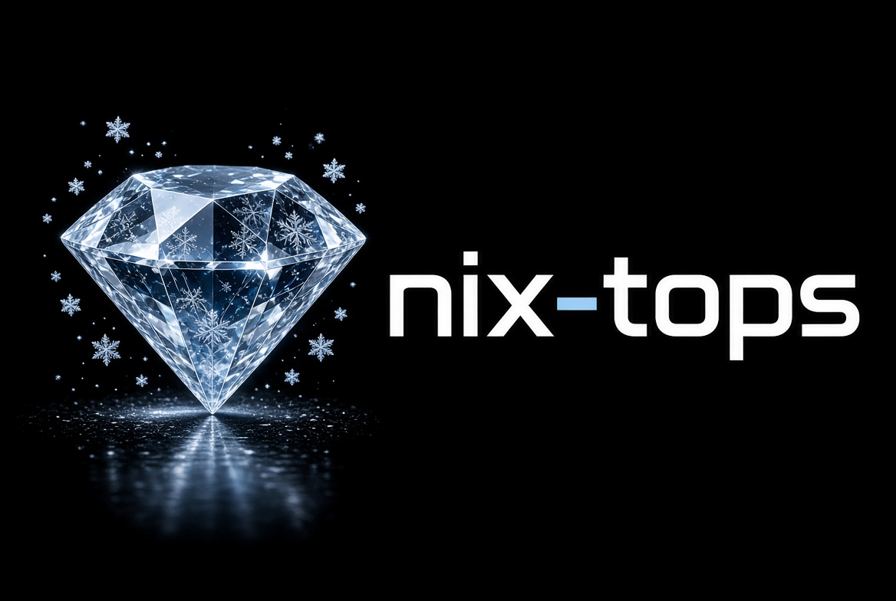

# Nix-TOPS

<p align="center">
  
</p>

<p align="center"><strong>A protocol and drop-in kit for Nix that is pure, correct, dense, and fast.</strong><br/>
Flakes, packages, NixOS and Home Manager modules, and the flake inside a Rust, Go, or web repo.</p>

<p align="center">
  <a href="https://nixos.org"></a>
  <a href="https://github.com/Hedronite"></a>
  <a href="NIX_TOPS.md"></a>
  <a href="LICENSE"></a>
  <a href="https://github.com/Hedronite/nix-tops/actions/workflows/nix-tops.yml"></a>
  <a href="https://github.com/Hedronite/nix-tops/actions/workflows/spec.yml"></a>
</p>

<p align="center">
  <a href="#quick-start">Quick start</a> ·
  <a href="#what-you-get">What you get</a> ·
  <a href="#how-it-works">How it works</a> ·
  <a href="#status">Status</a> ·
  <a href="NIX_TOPS.md">Protocol</a> ·
  <a href="AGENTS.md">Harness</a> ·
  <a href="CHANGELOG.md">Changelog</a>
</p>

<p align="center">
  Built by <a href="https://github.com/Hedronite">Hedronite</a>. Structure adapted from Rust-TOPS, Go-TOPS, and Web-TOPS.
</p>

---

Nix-TOPS (Nix Testing and Optimization Protocol Suite) is a protocol for Nix that is pure, correct, dense, and fast. It covers flakes, packages and overlays, NixOS and Home Manager modules and configurations, and the flake that sits in a Rust, Go, or web repository.

The gate evaluates every output on every declared system with warnings fatal, then builds, tests, and measures what the flake produces. This repository holds the spec, the schemas, the facet profiles, the laws as files, and the kit flake with the `nixtops` runner, a single Rust binary.

The package is unreleased (`0.0.0`) and has no tag. The runner covers the source and eval gates today; the sandbox checks, baseline and laws come in later milestones. No other repository has adopted it yet.

## Pins

| Plane | Pin | Where |
| --- | --- | --- |
| Protocol | 0.2.0 (draft) | [`NIX_TOPS.md`](NIX_TOPS.md) and the schemas |
| Package | 0.0.0, unreleased | [`crates/nixtops/Cargo.toml`](crates/nixtops/Cargo.toml). No tag |
| Systems | `x86_64-linux`, `aarch64-linux`, `aarch64-darwin` | [`nix-tops.toml`](nix-tops.toml). `x86_64-darwin` is unsupported |
| Runner toolchain | Rust 1.99.1, gated by Rust-TOPS | [`rust-toolchain.toml`](rust-toolchain.toml), [`rust-tops.yaml`](rust-tops.yaml) |
| Facet profiles | six | [`profiles/`](profiles/) |
| Laws | 49 | [`laws/`](laws/README.md), one TOML file per law |

## Quick start

From a clone of this repository, with flakes enabled:

```bash
nix run .#nixtops -- version
nix run .#nixtops -- check
nix run .#nixtops -- gate
```

`check` validates `nix-tops.toml` against the schema and the semantic rules. `gate` runs the enabled layers and writes `report.json`; `report` renders the last run, and `outputs` lists every output with its coverage level. `init` writes `nix-tops.toml`, the CI workflow and the `AGENTS.md` section into an adopting flake. `baseline` and `laws` print that they are not built yet and exit 4.

The spec checks run without Nix:

```bash
python3 -m unittest discover -s scripts/tests
python3 scripts/spec_check.py all
python3 scripts/rules_gen.py check
```

The schema check needs `check-jsonschema` 0.38.0, which needs Python 3.10 or later.

## What you get

| | A flake on its own | This kit today |
| --- | --- | --- |
| Contract | Whatever the repo documents | Protocol 0.2.0, JSON Schemas, six facet profiles, and 49 laws as files |
| A runner | `nix flake check` and the tools you wire | `nixtops` `version`, `doctor`, `check`, `init`, `gate`, `outputs`, `report`, run as `nix run .#nixtops` |
| Eval gate | Warnings scroll past | Every output on every declared system, with `abort-on-warn` and import-from-derivation off |
| CI on this repo | — | The kit gates itself `hard` (`nix-tops`), plus `kit`, `rust-tops`, `spec`, `fixtures` and `trial` workflows |

### What you do not get

| Claim | Reality |
| --- | --- |
| A released kit you can pin | The package is `0.0.0`, untagged. Kit distribution for adopters is M2 work |
| Sandbox lint, baseline, or the laws layer | `lib.mkChecks` (nixfmt, statix, deadnix, gitleaks), `baseline` and `ratchet` arrive at M2; the laws at M3 |
| Line coverage, CRAP, or mutation | Nix has no line coverage in this protocol. Coverage becomes output coverage, CRAP becomes closure and eval-cost budgets, and there is no mutation layer in 0.x. See [§6](NIX_TOPS.md#6-scoring-and-reporting) |
| A drop-in for nixpkgs contribution checks | `nixpkgs-vet` and nixpkgs CI do that for nixpkgs itself |

## How it works

The gate has two planes: hermetic checks in the Nix build sandbox, and a smaller set of checks that need the world outside it. One locked invocation: an adopter re-exports `apps.<system>.nixtops` and runs `nix run .#nixtops -- gate`, so no command resolves an unlocked reference. The evaluator that judges is the CppNix pinned in the kit's `flake.lock`.

What the protocol checks, as the layers land:

| Layer | How |
| --- | --- |
| Source | Every `.nix` file tracked by git; `flake.lock` committed and current |
| Lint | nixfmt (via `nixfmt-tree`), statix, deadnix, `nixtops-lint`, gitleaks, in the build sandbox |
| Eval | Every output on every declared system, with `abort-on-warn` and import-from-derivation off |
| Build and test | `nix flake check`, every package, dev shell and build root; nix-unit; NixOS VM tests |
| Output coverage | Every exported output: evaluated, built, tested |
| Budgets | Closure bytes per output; eval counters per output |

A repo can adopt Nix-TOPS alongside its language protocol: the language protocol judges the code, and Nix-TOPS judges the flake (`dev-flake` facet).

| Path | Role |
| --- | --- |
| [`NIX_TOPS.md`](NIX_TOPS.md) | The protocol, draft 0.2.0 |
| [`crates/nixtops/`](crates/nixtops/) | The runner |
| [`flake.nix`](flake.nix), [`nix/`](nix/) | The kit flake: `packages.nixtops`, `apps.nixtops`, dev shell, formatter |
| [`nix-tops.toml`](nix-tops.toml) | Nix-TOPS gating itself, `hard` |
| [`config/`](config/) | The `AGENTS.md` section and the CI workflow template that `nixtops init` writes |
| [`laws/`](laws/README.md) | One TOML file per law (49), and the table of `nix` diagnostics |
| [`profiles/`](profiles) | One floor profile per facet (six) |
| [`schema/`](schema) | JSON Schemas at protocol 0.2.0 |
| [`fixtures/`](fixtures/) | Fixture flakes the kit's own gate runs over |
| [`examples/quickstart/`](examples/quickstart/) | The adopter flake of §4 and a stub kit |
| [`scripts/`](scripts/) | Spec checks, generated rule copies, and the fixture and trial drivers |
| [`docs/evidence/`](docs/evidence/) | The gate-3 trial against eight pinned public flakes, and the warning-source fixtures |
| [`changelog.d/`](changelog.d/README.md) | Changelog fragments, one per protocol-change PR |
| [`AGENTS.md`](AGENTS.md) | Editing harness for this repository ([`CLAUDE.md`](CLAUDE.md) imports it) |

## Status

Draft. Protocol **0.2.0**. Package **0.0.0**, unreleased. No tag.

This repo is at milestone M1: the runner. The kit gates itself `hard` on gates 1 and 3 (source and eval) on x86_64 Linux and under Determinate Nix; the other layers and the laws are switched off with a reason until they are built. The kit has no `lib` output yet, so its own facets are `package-set` and `dev-flake`.

| Milestone | Contents |
| --- | --- |
| **M0** spec (done) | `NIX_TOPS.md`, schemas, six facet profiles (four launch, two specified and unproven), the laws as files, the AGENTS template |
| **M1** runner (current) | The kit flake and `nixtops`: `version`, `doctor`, `check`, `init`, `gate` for gates 1 and 3, `report.json`; the kit gates itself |
| M2 | Sandbox checks (`lib.mkChecks`): nixfmt, statix, deadnix, gitleaks; baseline and ratchet; first adopter |
| M3 | Laws v0.1: 29 of 49 judged; `nixtops-lint`; law fixtures |
| M4 | Output coverage; closure and eval-cost budgets; VM tests; calibrated floors |
| M5 | Adopters and the family toolchain |
| M6 | Tier 2 layers and the exact-answer features |
| M7 | Protocol 1.0 |

The full roadmap is in [`NIX_TOPS.md` §19](NIX_TOPS.md#19-roadmap).

## Related

- [Rust-TOPS](https://github.com/Hedronite/rust-tops): the original protocol.
- [Go-TOPS](https://github.com/Hedronite/go-tops): the Go protocol. Nix-TOPS starts from its 0.3.0 fixes.
- [Web-TOPS](https://github.com/Hedronite/web-tops): the web protocol.

## Contributing

Read [`NIX_TOPS.md`](NIX_TOPS.md) and [`AGENTS.md`](AGENTS.md) first. Before a PR is ready, run `python3 scripts/spec_check.py all` (the schema check needs `check-jsonschema` 0.38.0, which needs Python 3.10 or later), `python3 -m unittest discover -s scripts/tests` and `python3 scripts/rules_gen.py check`. Work on a branch and open a PR ready for review when the slice is complete, never a draft. A change to laws, schema, profiles, floors, budgets, eval options or normative spec text is a protocol change: it carries the `protocol-change` label, a changelog entry, and a protocol version bump.

## Credits and license

Built by [Hedronite](https://github.com/Hedronite). Structure adapted from Rust-TOPS, Go-TOPS and Web-TOPS. The laws draw on *Common Mistakes AI Coding Agents Make in Nix* (Hedronite sketch), with the corrections in [Appendix B](NIX_TOPS.md#appendix-b-corrections-to-the-source-sketch).

Licensed under MIT OR Apache-2.0, at your option. See [`LICENSE`](LICENSE), [`LICENSE-MIT`](LICENSE-MIT), and [`LICENSE-APACHE`](LICENSE-APACHE).

Unless you explicitly state otherwise, any contribution intentionally submitted for inclusion in this work, as defined in the Apache-2.0 license, shall be dual licensed as above, without any additional terms or conditions.
